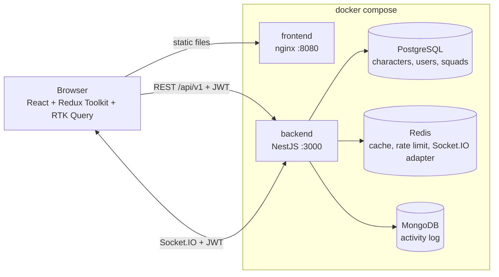
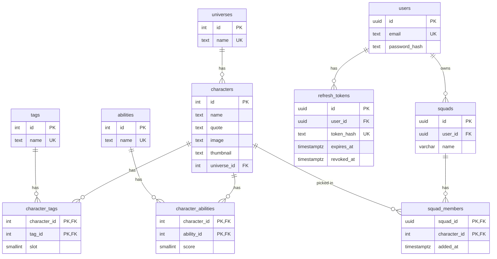

# Squad of Champions

[](https://github.com/ArtoNazaryan/VUZ-test-task/actions/workflows/ci.yml)

A fullstack version of the 360 VUZ "Squad of Champions" challenge: a NestJS API on PostgreSQL and Redis, and the React app from the frontend challenge connected to it. Also included: WebSockets (squad sync and live popularity, with the Redis adapter) and a MongoDB activity log (squad history and pick statistics).

**Note:** The original frontend challenge text is kept unchanged in [frontend/README.md](frontend/README.md).

## Contents

- [Quick start](#quick-start)
- [Architecture](#architecture)
- [Database schema](#database-schema)
- [API](#api)
- [Caching and invalidation](#caching-and-invalidation)
- [Concurrency](#concurrency)
- [Authentication](#authentication)
- [Frontend](#frontend)
- [Bonus features](#bonus-features)
- [Performance](#performance)
- [Tests](#tests)
- [Local development without Docker](#local-development-without-docker)
- [Decisions I've made](#decisions-ive-made)
- [Trade-offs and what I would improve](#trade-offs-and-what-i-would-improve)

## Quick start

Requirements: Docker with Docker Compose.

```bash
cp backend/.env.example backend/.env
docker compose up --build
```

This starts PostgreSQL, Redis and MongoDB, runs the migrations, seeds the characters from the original `characters.json`, and starts the API and the frontend. When everything is ready the frontend container prints the URLs:

| What         | URL                                 |
| ------------ | ----------------------------------- |
| Frontend     | http://localhost:8080               |
| API          | http://localhost:3000/api/v1        |
| Swagger      | http://localhost:3000/api/docs      |
| Health check | http://localhost:3000/api/v1/health |

Register an account on the frontend and start building squads. To start over with empty databases: `docker compose down -v`.

A Postman collection and environment are in [postman/](postman/). Import both, select the "Squad of Champions - local" environment and run **Auth > Register**; the access token is saved and used by every other request.

Host ports used: 8080, 3000, 5433 (PostgreSQL), 6379 (Redis), 27017 (MongoDB).

## Architecture



### Backend

NestJS 12 with TypeScript in strict mode, Prisma 7 with migrations, and zod validation of the environment at startup.

```
backend/src/
  main.ts, app.module.ts
  app/                      feature modules
    auth/  users/  characters/  squads/
    realtime/               Socket.IO gateway and squad event listener
    popularity/             most picked right now (PostgreSQL), live broadcast
    activity/               MongoDB activity log, history and pick stats
    health/
  infrastructure/           shared building blocks
    cache/  redis/  prisma/  mongo/  rate-limit/  realtime/ (Redis IO adapter)
    logger/  globals/ (exception filter, validation pipe)  config/  seed/
    common/                 constants, enums, DTOs, helpers shared by modules
    test/                   integration app factory, mocks, test helpers
```

Each feature module follows controller → service → repository, with DTOs (class-validator), mappers, pure helpers and its own Swagger decorators. Modules talk to each other through exported services, and squad changes are published as domain events (`@nestjs/event-emitter`). The realtime, popularity and activity modules listen to those events, so the squads module does not know about WebSockets or MongoDB.

Cross-cutting pieces:

- **Errors**: one global exception filter returns the same shape for every error, with a stable `error` code (see [Error responses](#error-responses)).
- **Logging**: structured JSON logs with pino. Every request gets a request id, taken from the `x-request-id` header or generated, returned in the response header and in error bodies.
- **Validation**: a global validation pipe with whitelisting; unknown fields are rejected.
- **Rate limiting**: `@nestjs/throttler` with a custom Redis storage, 100 requests per minute per client and 10 per minute on register, login and refresh. If Redis is down the limiter lets requests through instead of failing them.
- **Security**: helmet, CORS limited to `CORS_ORIGINS`, argon2id password hashing.
- **Configuration**: everything comes from environment variables, validated with zod at startup. See [backend/.env.example](backend/.env.example).

### Frontend

Vite, React 19, MUI 9, Redux Toolkit with RTK Query, React Router, react-hook-form with zod, organised with Feature-Sliced Design:

```
frontend/src/
  app/        store, providers (theme, session bootstrap, realtime bridge), router, layout
  pages/      login, register, squad-builder
  widgets/    masthead, squad-header, character-table, popularity-strip
  features/   login-form, register-form, logout, character-search, character-filters,
              squad-picker, toggle-squad-member, squad-history
  entities/   session, character, squad (API endpoints, slices, small UI pieces)
  shared/     api client, config, UI kit, helpers, hooks, test utilities
```

## Database schema



I designed the schema this way because:

- **Universes, tags and abilities are their own tables.** They repeat across characters and are what the UI filters on, so the filter options are a cheap `SELECT name` and filtering is a join on an integer key instead of matching strings inside JSON.
- **Character ids are kept from the JSON file.** The seed is idempotent (upsert by id, then the character's tags and abilities are replaced), so running it again never creates duplicates and ids stay stable for existing squads.
- **`character_tags.slot`** keeps the original order of a character's tags, so the API returns them exactly as in the file.
- **`character_abilities.score`** has a CHECK constraint (1 to 10) taken from the data. Ability names come from the data, not from code, so a new ability in the file would just appear.
- **`squad_members` has a composite primary key `(squad_id, character_id)`.** The database itself makes "a character cannot appear twice in a squad" impossible to break, even under concurrent requests. `added_at` keeps the order in which members were added.
- **`squads` has `UNIQUE (user_id, name)`**, so a user cannot have two squads with the same name.
- **UUID v7 ids** for users, squads and refresh tokens: not guessable, and time-ordered so they index well.
- **Refresh tokens are stored as SHA-256 hashes**, never as the token itself.

Indexes:

| Index                                           | Used for                                  |
| ----------------------------------------------- | ----------------------------------------- |
| `characters (name, id)`                         | sorting by name and the keyset cursor     |
| `characters USING gin (name gin_trgm_ops)`      | `ILIKE '%text%'` name search (pg_trgm)    |
| `characters (universe_id)`                      | universe filter                           |
| `character_tags (tag_id)`                       | tag filter                                |
| `squad_members (character_id)`                  | popularity counts                         |
| `refresh_tokens (user_id)`, `token_hash` unique | session lookups and revoking all sessions |

The migrations are in [backend/prisma/migrations](backend/prisma/migrations). The trigram extension and index are written by hand because Prisma cannot express them.

## API

All endpoints use the `/api/v1` prefix and are documented in Swagger at http://localhost:3000/api/docs, including every error response with examples.

| Method | Endpoint                              | Auth   | Description                                                            |
| ------ | ------------------------------------- | ------ | ---------------------------------------------------------------------- |
| POST   | `/auth/register`                      |        | Create an account; returns an access token and sets the refresh cookie |
| POST   | `/auth/login`                         |        | Log in; same response as register                                      |
| POST   | `/auth/refresh`                       | cookie | New access token from the refresh cookie (rotates the refresh token)   |
| POST   | `/auth/logout`                        | cookie | Revoke the refresh token and clear the cookie                          |
| GET    | `/auth/me`                            | yes    | Current user                                                           |
| GET    | `/characters`                         |        | `search`, `tags`, `universes`, `limit`, `cursor`, `sort`               |
| GET    | `/characters/filters`                 |        | All universes, tags and ability names                                  |
| GET    | `/characters/:id`                     |        | One character                                                          |
| GET    | `/squads`                             | yes    | Your squads with member counts                                         |
| POST   | `/squads`                             | yes    | Create (name, optional up to 6 character ids)                          |
| GET    | `/squads/:id`                         | yes    | Squad with its characters and ability averages                         |
| PATCH  | `/squads/:id`                         | yes    | Rename and/or replace the characters                                   |
| DELETE | `/squads/:id`                         | yes    | Delete                                                                 |
| POST   | `/squads/:id/characters/:characterId` | yes    | Add a character                                                        |
| DELETE | `/squads/:id/characters/:characterId` | yes    | Remove a character (idempotent)                                        |
| GET    | `/squads/:id/history`                 | yes    | Squad timeline from MongoDB (bonus)                                    |
| GET    | `/popularity`                         |        | Most picked characters right now (bonus)                               |
| GET    | `/stats/picks?days=7`                 |        | Most added characters in the last N days, MongoDB aggregation (bonus)  |
| GET    | `/health`                             |        | PostgreSQL and Redis status                                            |

Squad routes only ever return the caller's own squads. Someone else's squad answers 404, not 403, so ids cannot be probed.

### Pagination

`GET /characters` uses **cursor (keyset) pagination** on `(name, id)`. The response has `items` and `nextCursor`, and the next page is `?cursor=<nextCursor>`.

I chose cursor over offset because the frontend loads more results while scrolling, so it never needs "jump to page 7", which is offset's only advantage. Keyset pages don't skip or repeat rows when data changes between requests, and the query stays an index range scan however deep you scroll, while `OFFSET n` reads and throws away n rows. The cursor is an opaque base64url token, validated on the server, and it is tied to the sort order, so mixing a cursor with another sort returns 400. The same approach is used for the squad history (`occurredAt, _id`).

Search and filters can be combined:

- `search`: case-insensitive "contains" on the character name or any of its tag names.
- `tags` / `universes`: comma separated, matching any of the given values.
- `sort`: `name` (default) or `-name`.

### Squad rules

Enforced on the server, whatever the client sends:

- at most 6 characters (`422 SQUAD_FULL`)
- no character twice in the same squad (`409 CHARACTER_ALREADY_IN_SQUAD`, also guaranteed by the primary key)
- every character id must exist (`422 CHARACTER_NOT_FOUND`)
- unique squad names per user (`409 SQUAD_NAME_TAKEN`)

Statistics are computed by the server: the average of each ability across the squad's characters, rounded to two decimals, or `null` for an empty squad.

### Error responses

Every error has the same shape. `details` is only present when there is something useful to add, such as validation messages per field.

```json
{
  "statusCode": 422,
  "error": "SQUAD_FULL",
  "message": "A squad cannot have more than 6 characters",
  "details": { "limit": 6, "requested": 7 },
  "requestId": "3bb2820b-e0bd-485a-ad7b-49d45974b1ae"
}
```

| Status | `error`                      | When                                                                      |
| ------ | ---------------------------- | ------------------------------------------------------------------------- |
| 400    | `VALIDATION_ERROR`           | invalid body or query (per-field `details`), invalid cursor               |
| 400    | `BAD_REQUEST`                | malformed path parameter, for example a squad id that is not a UUID       |
| 401    | `UNAUTHORIZED`               | missing, invalid or expired access token; missing or reused refresh token |
| 401    | `INVALID_CREDENTIALS`        | wrong email or password (same answer for both)                            |
| 404    | `NOT_FOUND`                  | unknown character, or a squad that is not yours                           |
| 409    | `EMAIL_TAKEN`                | registering an existing email                                             |
| 409    | `SQUAD_NAME_TAKEN`           | duplicate squad name for the same user                                    |
| 409    | `CHARACTER_ALREADY_IN_SQUAD` | adding a character twice                                                  |
| 422    | `SQUAD_FULL`                 | more than 6 characters                                                    |
| 422    | `CHARACTER_NOT_FOUND`        | a character id that does not exist                                        |
| 429    | `TOO_MANY_REQUESTS`          | rate limit exceeded                                                       |
| 500    | `INTERNAL_ERROR`             | unexpected errors (details only in the logs)                              |
| 503    | `SERVICE_UNAVAILABLE`        | health check when PostgreSQL or Redis is down                             |

## Caching and invalidation

| Data                  | Key                                               | TTL   | Invalidation                  |
| --------------------- | ------------------------------------------------- | ----- | ----------------------------- |
| Character list pages  | `characters:v{n}:list:<hash of normalised query>` | 1 h   | version bump                  |
| Single character      | `characters:v{n}:item:<id>`                       | 1 h   | version bump                  |
| Filter options        | `characters:v{n}:filters`                         | 1 h   | version bump                  |
| Most picked right now | `popularity:top`                                  | 5 min | rewritten after squad changes |
| Pick statistics       | `stats:picks:<days>`                              | 60 s  | expires                       |

- **Characters** only change when the seed runs. Instead of finding and deleting every list key (search, filters, cursors and limits make the number of combinations unbounded), all character keys include a version number. The seed bumps the version after it writes, so the next request reads fresh data and the old keys simply expire. The query is normalised before hashing (lower-cased search, sorted and de-duplicated tags and universes), so equivalent requests share one cache entry.
- **Squads are not cached.** They are per user and read right after being written, so a cache would only add invalidation risk. The squad page is still fast: the squad and its member ids come from one indexed query, its characters are loaded in one batch (no N+1), and the ability names used for the statistics come from the cache.
- **Popularity** is computed with one `GROUP BY` and cached. Squad changes schedule a refresh that runs at most once per second (bursts are coalesced), writes the new value to the cache and broadcasts it over WebSocket.
- **Failures**: if Redis is unavailable, cache reads and writes are skipped and the API answers from PostgreSQL. The health check reports Redis as down.

## Concurrency

"Two requests adding characters at the same time must never result in more than 6 members."

Adding a member runs in one transaction that first locks the squad row with `SELECT … FOR UPDATE`, then counts the members, checks the rules and inserts. A second request for the same squad waits on the lock, then sees the new count and gets `422 SQUAD_FULL`. Requests for different squads don't block each other. Duplicate members are also impossible because of the primary key; a unique-violation from a race is turned into `409 CHARACTER_ALREADY_IN_SQUAD`.

This is covered by integration tests against a real PostgreSQL. A squad with 4 members gets 8 add requests at the same time: exactly 2 succeed, 6 get `SQUAD_FULL`, and the squad ends with 6 members. Adding the same character 5 times at once adds it only once. Removing `FOR UPDATE` makes the first test fail.

## Authentication

- **Passwords** are hashed with argon2id. Login runs a dummy hash for unknown emails, so response time doesn't reveal whether an account exists.
- **Access token**: a JWT valid for 15 minutes, sent as `Authorization: Bearer`. The frontend keeps it in memory only (Redux), never in localStorage, so an XSS bug cannot read a long-lived token.
- **Refresh token**: a random token in an `httpOnly`, `SameSite=Strict` cookie scoped to the auth path, valid for 7 days, stored hashed. Every refresh rotates it. Reusing an already-rotated token revokes all of the user's sessions (token theft detection), except within a 10 second grace window so two tabs refreshing at the same moment don't log each other out.
- **Session restore**: on page load the frontend calls `/auth/refresh`, so a reload keeps you logged in without storing the access token. A 401 from any request triggers one shared refresh and a retry of the original request.
- **WebSockets** authenticate with the same access token in the Socket.IO handshake.

## Frontend

What changed compared to the frontend-only challenge:

- **No JSON import in the UI**: characters, filter options and squads all come from the API through RTK Query.
- **Server-side filtering**: debounced search (300 ms), tag and universe filters, and infinite scroll using the API cursor.
- **Auth**: login and register pages with validation, protected routes, the in-memory token with silent refresh described above, and logout.
- **Squads through the API**: several squads per user (create, rename, delete, switch; the last selected squad is remembered per user), checkboxes to add or remove characters, a "My Team" filter, and averages computed by the server.
- **Optimistic updates with rollback**: ticking a character updates the table, the avatars and the squad list instantly. If the server refuses (for example `SQUAD_FULL` from another tab), the change is rolled back and the server's message is shown.
- **States**: loading skeletons, empty states, error states with retry, and a disabled checkbox with an explanation when the squad is full.
- **Configuration**: the API URL comes from `VITE_API_URL`. The backend allows the frontend origin through `CORS_ORIGINS`.
- **Realtime**: one Socket.IO connection per logged-in session, wired into the Redux store (see below).

The Docker image is built with Vite and served by an unprivileged nginx with SPA fallback and long-term caching for hashed assets.

## Bonus features

### WebSockets

- A NestJS gateway (Socket.IO) authenticated with the same JWT. Every socket joins a `user:<id>` room.
- **Squad sync**: every squad change is pushed as `squad:changed` to all sessions of that user. The frontend refetches exactly the affected squad, its history and the squad list, so other tabs and devices update instantly.
- **Live popularity**: `popularity:updated` is broadcast to everyone after squad changes (throttled to once per second). The frontend writes it straight into the RTK Query cache and shows it in the "Most picked right now" strip; clicking a character searches for it.
- **Redis adapter**: `@socket.io/redis-adapter`, so events reach clients connected to any API instance. An integration test runs two API instances and checks that an event from one reaches a client on the other.

### MongoDB activity log

Every squad event (created, updated, deleted, character added, character removed) is stored as a document in `activity_events`:

```json
{
  "type": "squad.member-added",
  "userId": "…",
  "squadId": "…",
  "characterId": 25,
  "occurredAt": "2026-10-13T10:00:00.000Z"
}
```

Created and updated events also carry `details` (`name`, `characterIds`). Writes are best-effort: if MongoDB fails, the squad request still succeeds and the error is logged.

Endpoints that use it:

- `GET /squads/:id/history`: the squad timeline, newest first, with cursor paging. It is shown in the frontend in a history drawer that updates live.
- `GET /stats/picks?days=7`: an aggregation pipeline (`$match` "added" events in the window → `$group` by character → `$sort` → `$limit` 10), joined with character data from PostgreSQL and cached for 60 seconds.

Indexes: `{ squadId, occurredAt desc, _id desc }` for the timeline, and `{ type, occurredAt, characterId }` for the statistics, which lets MongoDB answer the aggregation from the index alone.

**I decided that a document store fits this data because:** the log is append-only and never updated, it is written on every squad change (write-heavy), it is always read in time order, and different event types carry different payloads. It needs no joins or foreign keys, and old events must survive even after the squad, or one day the user, is deleted. In PostgreSQL this would be a growing table with nullable or JSON columns sitting next to the transactional data. MongoDB keeps it separate, flexible and easy to aggregate.

**I kept "most picked right now" in PostgreSQL because:** it describes the current state (which squads contain which characters), and that state lives in PostgreSQL, so one `GROUP BY` on `squad_members` is always exact. The MongoDB statistic answers a different question: how often a character was added over a period.

### Other extras

- Refresh tokens with rotation and reuse detection
- Rate limiting backed by Redis (`X-RateLimit-*` headers; `Retry-After` on 429, named `Retry-After-strict` for the auth limit)
- Structured JSON logging with request ids
- GitHub Actions CI ([.github/workflows/ci.yml](.github/workflows/ci.yml)):
  - backend: format check, lint, type check, unit tests, integration tests with Testcontainers
  - frontend: format check, lint, type check, tests, production build
  - a Docker Compose smoke test that builds and starts the whole stack and checks the API and the frontend
- Postman collection in [postman/](postman/)
- Swagger documentation of every endpoint, with tests that check every route is documented, protected routes declare the bearer token, every route documents the rate limit, and error examples use the shared error shape

## Performance

I measured on my MacBook with Docker, 208 characters, using `autocannon -c 20 -d 10` against the backend container with the rate limit raised:

| Request                                    | Redis cache                     | Without cache (Redis stopped)     |
| ------------------------------------------ | ------------------------------- | --------------------------------- |
| `GET /characters` first page               | 5,877 req/s, p50 3 ms, p99 7 ms | 1,358 req/s, p50 14 ms, p99 23 ms |
| `GET /characters?search=…&tags=…&limit=50` | 3,775 req/s, p50 5 ms           | 874 req/s, p50 22 ms              |
| `GET /characters/:id`                      | 11,840 req/s, p50 1 ms          | 2,624 req/s, p50 7 ms             |

- **No N+1**: a list request is always 6 SQL queries (characters, then universes, tags and abilities loaded in batches), whether the page has 21 or 51 rows.
- **Indexes are used**: `EXPLAIN ANALYZE` shows an index scan on `characters (name, id)` for the first page and for cursor pages (about 0.03 ms). With 208 rows PostgreSQL rightly chooses a sequential scan for tag and universe filters; with sequential scans disabled it switches to the universe and tag indexes, so they are ready for a bigger catalogue.
- **Squad page**: one indexed query for the squad, one batched load of its characters, and cached metadata. Squad changes from the UI are optimistic, so the page reacts before the server answers.

What I would measure next: p95 latency per route in production (the request ids and structured logs are ready for that), and the search query at catalogue sizes where the trigram index matters (see trade-offs).

## Tests

|          | Unit                                                                                                                     | Integration / e2e                                                                                        |
| -------- | ------------------------------------------------------------------------------------------------------------------------ | -------------------------------------------------------------------------------------------------------- |
| Backend  | 253 tests (Vitest): squad rules, statistics, cursors, cache keys, auth helpers, services, mappers                        | 106 tests against real PostgreSQL, Redis and MongoDB (Testcontainers) through the HTTP API and Socket.IO |
| Frontend | 165 tests (Vitest, Testing Library, MSW): slices, helpers, components, features, auth flow, optimistic updates, realtime |                                                                                                          |

Backend integration tests cover the main endpoints end to end, the squad rules, the concurrency guarantee, rate limiting, refresh token rotation and reuse, caching, the WebSocket gateway, the Redis adapter with two instances, the MongoDB activity log, and the Swagger document.

Run them (Node 22 or newer; integration tests need Docker running):

```bash
cd backend
npm ci
npm test            # unit tests
npm run test:int    # integration / e2e tests, starts its own containers
npm run lint && npm run typecheck

cd ../frontend
npm ci
npm test
npm run lint && npm run typecheck
```

## Local development without Docker

Start only the databases with Docker, then run the apps with hot reload:

```bash
docker compose up -d postgres redis mongo
cp backend/.env.example backend/.env

cd backend
npm ci
npm run db:migrate
npm run db:seed
npm run start:dev    # http://localhost:3000

cd ../frontend
npm ci
npm run dev          # http://localhost:5173
```

`backend/.env.example` already points to the databases on their published ports and allows the Vite dev server origin. The frontend uses `http://localhost:3000/api/v1` unless `VITE_API_URL` is set.

## Decisions I've made

- **A user can have several squads** ("CRUD squads" in the brief). The frontend creates "My squad" automatically on the first visit and remembers the last selected squad per user.
- **The characters file stays where the frontend challenge put it** (`frontend/src/data/characters.json`) and is never changed. The backend seed reads it from there; in Docker it is mounted read-only into the backend container.
- **Search** matches the character name or any of its tag names, case-insensitively, because the original UI searched both. **Tag and universe filters** match any of the selected values, and the two filters combine with AND.
- **Vite instead of Create React App**: I used Vite because CRA is deprecated and nothing in the brief requires it.
- The order of characters in a squad is the order in which they were added.
- Email verification, password reset and OAuth are out of scope, as stated in the brief.

## Trade-offs and what I would improve

- **Search and the trigram index**: the trigram index is used for name-only search, but the combined "name OR tag name" search (an `OR` with an `EXISTS` subquery) cannot use it. At scale I would add a precomputed search column (name plus tag names) with its own trigram index, or use full-text search.
- **MongoDB at startup**: the API waits for MongoDB when it starts (Compose takes care of that), but MongoDB going down later never fails a squad request. It is left out of `/health`, because the API works without it.
- **Pick statistics** count only "add character" actions. Characters included when creating a squad, or replaced in bulk with PATCH, are not counted (the UI always adds one at a time). Storing one event per added character for those cases would fix it.
- **Mongoose builds the indexes on startup** (`autoIndex`). In production I would create them in a migration step instead.
- **History of deleted squads** is kept in MongoDB but has no endpoint, because the history route checks ownership through PostgreSQL. An audit endpoint per user would expose it.
- **Frontend bundle**: one JavaScript chunk of about 900 kB (285 kB gzipped). Lazy-loading the login and register pages and splitting vendor chunks would reduce the first load.
- **Rate limiting by IP**: behind a load balancer, Express `trust proxy` must be configured so the real client IP is used.
- **Access token in memory** means one refresh call per page load. That is deliberate (safer than localStorage), at the cost of one small request.
- Also, with more time: a live demo deployment, Playwright end-to-end tests of the main UI flows, request metrics (Prometheus) and tracing, and an audit view of a user's full activity.
